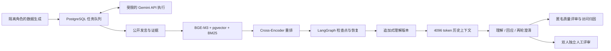

# 心迹 TraceMind

动态心理理解记忆与多会话评测研究框架。系统将事件证据、心理状态、解释假设和待澄清问题分开维护，用支持与反驳证据修订认识，再评测对后续回应的影响。

**v0.2 状态：**20组场景计划已逐场个别化并通过独立模型审查；对话与正式实验仍在生成。最新实际数量见[运行状态](docs/status.json)。200组双人盲评待人工完成，不包含虚构人工评分或目标效果数字。案例均为虚构成人的合成材料。

当前数据合成已改用用户指定的 `gemini-3.8-flash`，使用独立 `gemini_v1` 数据版本。每次调用前必须读取[项目 API skill](.agents/skills/tracemind-api/SKILL.md)：并发最多 4、所有请求共享的开始间隔至少 10 秒，用户已取消每批 20 条和每日数量上限；错误处理及最多两次重试规则保留。代理日志与实际最小对话已确认用户允许的 `gemini-3.8-flash → gemini-3.8-flash-tiered` 映射，记录请求与返回名称；最初被名称完全相等校验拦截的批次保留为历史记录。最新合成进度见运行状态。

此前 Terra v2 保留来源并停止合成，不与 Gemini 数据混合。v1 的四场公开样例只用于工程冒烟，不计入正式 Benchmark 数量。



| 子系统 | 代码（位于 `src/tracemind/`） | 职责 |
| --- | --- | --- |
| 领域与持久化 | `memory/`、`storage/` | 逐条证据、适用时间、支持/反驳、版本链与事务 |
| 检索 | `retrieval/` | 个案和时间过滤、向量/词项融合、重排 |
| 工作流 | `workflows/`、`jobs.py` | LangGraph 恢复、模型任务导出和实际结果导入 |
| 数据与实验 | `benchmark/`、`experiments/` | 角色隔离、反事实冻结、六条件、理解与短互动 |
| 评测与界面 | `evaluation/`、`web/` | 引用校验、访问受限单列、场景聚类、双人锁定评审 |

## 安装与运行

使用 Python 3.11、uv 和锁定依赖。本机 PostgreSQL 17 与 pgvector 安装见[基础设施说明](docs/infrastructure.md)。

```powershell
uv sync --extra dev --extra retrieval --frozen
uv run python scripts/setup_database.py
uv run tracemind db init
uv run tracemind doctor
uv run pytest
```

数据库连接由忽略提交的 `.env` 中 `TRACEMIND_DSN` 提供，默认只监听 `127.0.0.1:55432`。BGE-M3与重排权重固定到具体 revision，保存在 `.local/` 并顺序加载；CUDA不可用或显存不足时使用同一模型的CPU推理。

合成通过受限 API 执行器运行，凭据从 `TRACEMIND_API_BASE_URL`、`TRACEMIND_API_KEY`、`TRACEMIND_API_MODEL` 或忽略提交的 `.local/api-config.json` 读取。仅使用指定请求模型，先检查模型列表；全局文件锁、SQLite 尝试账本、持久化等待及停止标记共同执行限额。实际发送的裁剪输入、响应、请求/返回模型、真实可用的 usage 及来源哈希保存在本机。仅允许 skill 中用户明确批准的返回名称映射，其他差异仍停止。

```powershell
# 必须先读取项目 API skill；凭据仅放环境或本地忽略配置。
# 已授权持续推进20组场景；不指定 --limit 时直至场景合成完成或错误停止。
uv run python scripts/gemini_batch.py --batch-id RUN_ID
# Windows 后台运行 / 恢复同一运行，重复启动会检查并复用现有进程：
powershell -File scripts/start_synthesis.ps1
```

后台状态、进程号和脱敏日志位于 `.local/api/`。程序不会因 20 条或跨日自动停止；鉴权、账户/服务提示、超额重试等错误仍停止。电脑、本地代理和 PostgreSQL 需要保持运行。创建 `.local/api/STOP` 可在下一请求发送前暂停；移除后可恢复原运行。

历史的 Agent 任务导出/导入仍用于保留旧实验和评测记录，Python 不会自行启动 Codex 子 Agent。以下命令不应被用来重启 Terra 数据合成：

```powershell
uv run tracemind jobs export .local/outbox
# 指定子Agent实际生成结果并记录来源后：
uv run tracemind jobs import .local/result.json
uv run tracemind benchmark audit .local/datasets/gemini_v1
```

研究查看器与人工盲评入口分开运行，使用不同访问凭据：

研究查看器按记忆流呈现追加版本、当前待澄清问题、支持与反驳证据、替代关系和适用时间；证据标识可跳转到原始发言，完整 JSON 保留在折叠区。模型支持状态不代表人工或临床认可。查看器读取本地数据库，不调用生成模型；匿名评审入口不会因此获得研究者的记忆视图。

```powershell
# 设置随机 TRACEMIND_EXPLORER_SECRET（至少32字符）后：
uv run tracemind explorer serve
# PACKETS 必须来自实际候选回应，不能用测试夹具代填：
uv run tracemind review init .local/reviews.sqlite3 .local/packets.json reviewer1 reviewer2
# 设置随机 TRACEMIND_REVIEW_SECRET 后：
uv run tracemind review serve .local/reviews.sqlite3
```

[架构与任务恢复](docs/architecture.md) · [数据卡](docs/data_card.md) · [评测与统计协议](docs/evaluation.md)

[全项目执行与验收](docs/project_execution.md)说明从持续合成到首组端到端验证、校准冻结、正式测试、人工配对工具和实测报告的阶段流程。后台入口为 `scripts/start_synthesis.ps1`，阶段状态位于忽略提交的 `.local/project/status.json`。计算实验不会因为单一模块成功就被标为项目完成。

[Gemini 开发集示例](data/examples/gemini_v1/)包含三场经模型内容审查并核验来源的完整会话。持续生成会在会话完成后执行独立请求审查，拒绝则保存问题并停止；通过后使用 BGE-M3 和 pgvector 增量入库。内容审查、自动核查和人工评审分别记录，不互相代替。

首组开发场景已完成24场会话、12个检查点的六条件工程验证，包含72份理解作答和72份回应；实际输入权限及4,096 token历史预算核查通过，见[验证汇总](docs/first_group_smoke.json)。该汇总只证明已运行的工程流程，正式测试效果与人工盲评仍待完成。

新测试组设定、匿名映射和人工表位于忽略提交的 `.local/`。模型合成和评分存在共同偏好，不能称作人工或临床认可。

## 历史归档

本仓库保存一组**合成咨询对话**上的探索性实验，研究跨会话历史、按需重建和滚动维护的心理理解记录如何影响模型的理解与下一轮回应。数据不来自真实来访者；模型评分未经人工或临床校准，不能用于临床判断。

| 目录 | 内容 |
| --- | --- |
| [`pilot_three_cases/`](pilot_three_cases/) | 三例早期纵向实验及生成、审计脚本 |
| [`p0_understanding_in_action/`](p0_understanding_in_action/) | 8 例、64 次会话、24 个检查点的现象实验 |
| [`p1_evaluation/`](p1_evaluation/) | DeepSeek Pro 作答、Qwen Flash 评审的 P1 分析 |
| [`p1_1_qwen_rerun/`](p1_1_qwen_rerun/) | Qwen Flash 作答、Qwen Max 评审的独立复测 |

建议先阅读各目录的 `README.md` 和报告，再查看保存的答卷、评分与审计记录。两个 P1 版本都**没有证明**滚动维护优于从完整历史按需重建；新旧版本同时更换了作答和评审模型，不能将分数变化归因于单一因素。

脚本通过运行环境中的 `DASHSCOPE_API_KEY` 读取密钥。请勿将密钥、真实来访者资料或其他私人数据提交到仓库。
